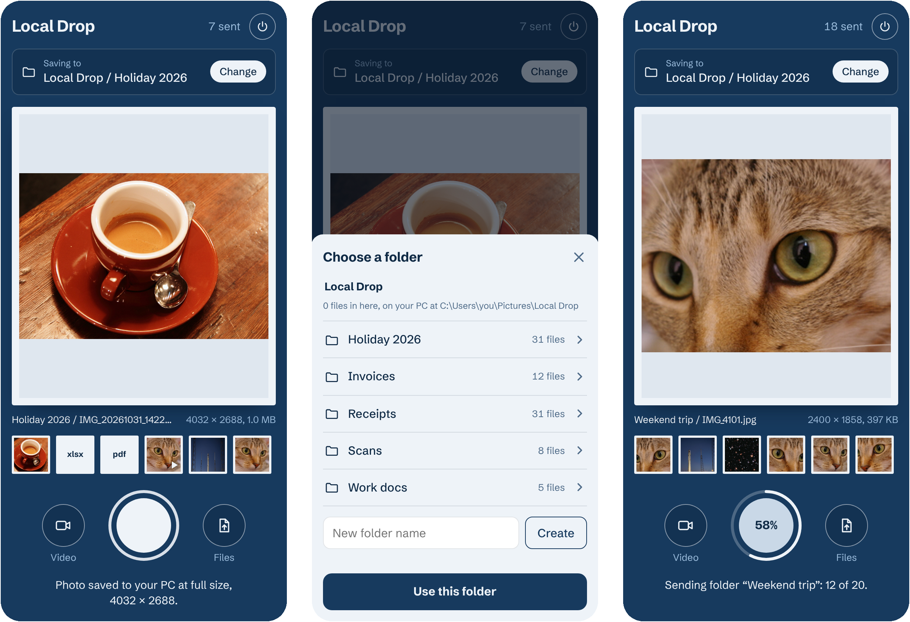
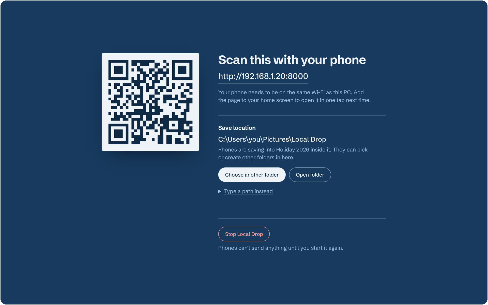
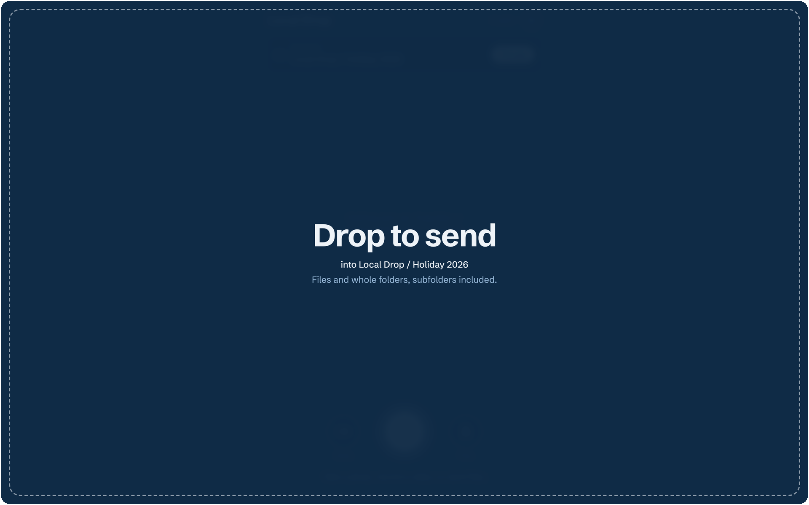

# Local Drop

Send photos, videos, files and whole folders from your phone to a folder on your Windows PC over Wi-Fi. No app to install, no cloud, no account. Just one Python file and a browser.

<p align="center">
  
</p>

<p align="center">
  
  &nbsp;
  
</p>

## How it works

1. **Start it on your PC.** `Start Local Drop.bat` runs a small web server on your PC (port 8000) and opens a page with a QR code.
2. **Scan the code with your phone.** Your phone must be on the same Wi-Fi. The phone page has three buttons:
   - The big shutter button takes a photo.
   - **Video** records a video.
   - **Files** sends files from your phone, or a whole folder with its subfolders.
3. **Send.** Each file uploads over your local network as soon as you take or pick it. It's written to disk byte for byte, so photos keep their full resolution and metadata. The phone shows each photo's saved size, for example 4032 × 3024.
4. **Choose where files go.**
   - On the PC page, set the main save folder with the Windows folder picker, or type a path.
   - On the phone, browse, create and pick folders inside it.
   - Both choices are remembered between runs.
5. **Stop it** with the Stop button on either page, or by closing the console window.

On a laptop or tablet on the same network, you can open the same address and drag files or whole folders onto the page.

Nothing leaves your network. Files never pass through a third-party server.

## Quick start

1. Install [Python 3.8+](https://www.python.org/downloads/). During setup, tick **Add python.exe to PATH**.
2. Put `local_drop.py` and `Start Local Drop.bat` in the same folder, then double-click the `.bat`.
3. When Windows Firewall asks, allow Python on **Private** networks. If your phone still can't connect, set the Wi-Fi to *Private* in Windows network settings.

To run it from a terminal instead:

```
python local_drop.py [--port 8000] [--dir "D:\Photos"] [--no-browser]
```

`--dir` sets the folder to start with. Once you choose a folder on the PC page, that choice is used instead. Settings are stored in `%APPDATA%\LocalDrop\settings.json`.

## Built with

- **Python 3 standard library only.** No `pip install` needed:
  - `http.server` (`ThreadingHTTPServer`) runs the server.
  - `pathlib` and `shutil` handle files and free-space checks.
  - `tkinter` shows the native folder picker.
- **Plain HTML, CSS and JavaScript.** No framework and no build step. Both pages are built into `local_drop.py`.
- **HTML Media Capture** (`<input type="file" capture>`) opens the phone's own camera app. This works over plain HTTP on a local network; live in-browser camera APIs require HTTPS.
- **Folder picking and drag-and-drop** use `<input webkitdirectory>` and the File and Directory Entries API (`webkitGetAsEntry`).
- **`XMLHttpRequest` uploads** stream straight to disk in 1 MB chunks, with live progress. An interrupted upload never leaves a half-written file.
- **Third-party assets:**
  - [qrcode.js](https://github.com/davidshimjs/qrcodejs), from cdnjs, draws the QR code.
  - [Schibsted Grotesk](https://fonts.google.com/specimen/Schibsted+Grotesk), from Google Fonts, is the typeface.
  - Both pages still work if these don't load.

## Good to know

- **Nothing is overwritten.**
  - Files keep their own names. If a name is taken, the new file is saved as `name (2).ext`.
  - A folder you send arrives under its own name. If that name is taken, it arrives as `Holiday (2)`, so two sends never mix.
  - Photos and videos taken from the page are named `IMG_`/`VID_` plus the date and time.
- **No size limit.** Local Drop checks there's enough free disk space before each file is sent.
- **The phone is boxed in.** It can only see and create folders inside the main save folder. Changing the main folder, or opening it in Explorer, only works from the PC itself.
- **Folder picking on phones** needs Chrome 132+ on Android, Safari on iOS 18.4+, or Firefox 142+ on Android. On older browsers, the Files button sends files only.
- **iPhone quirks.** These are iOS behaviour that no web page can change:
  - Photos keep their full resolution, but iOS may convert HEIC to JPEG on the way. In the photo picker, *Options → Format → Current* keeps the original.
  - iOS shrinks videos picked from the Photos library. To send an original video, save it to the Files app first, then use **Files → Files → Choose File**.
- **Run it only on networks you trust.** Anyone on the same Wi-Fi who opens the address can send files into your save folder.

Sample photos in the screenshots come from [scikit-image](https://scikit-image.org/docs/stable/api/skimage.data.html):
- the coffee and cat photos are CC0;
- the rocket and Hubble images are public domain.
